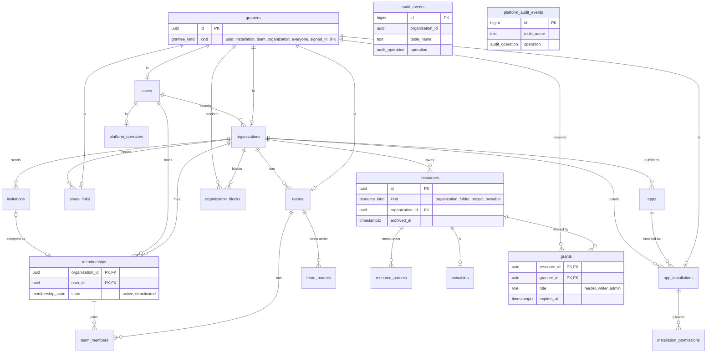

# connetto-schema

A PostgreSQL core schema for multi-tenant applications whose access rules live in row-level security. Its policies are written to translate one to one into an OpenFGA model through [rls2fga](https://github.com/connetto-rs/rls2fga), and [pg2sqlite](https://github.com/connetto-rs/pg2sqlite) turns the schema into the SQLite replica a client holds offline. Application schemas are applied on top of it.

Anything that can receive access is a grantee, and a grant gives one grantee a role on one resource. Resources form a tree under their organization (folders, projects, and the ownables inside a project), and a grant on a node reaches everything below it. Triggers record every change to an organization's tables in `audit_events`, and every change to users, organizations and platform operators in `platform_audit_events`.

## Layout

| Path | Holds |
|---|---|
| [`sql/`](sql) | The schema, one slice per directory, applied in name order after [`cluster/roles.sql`](cluster/roles.sql) |
| [`crates/`](crates) | The [synql](https://github.com/connetto-rs/synql) crate `connetto-schema`, written by [`generate/`](generate). Its default `models` feature holds the Diesel models of every table and enum, `sqlite` adds their SQLite conversions, and with `default-features = false` it holds only the `DESCRIPTION` a schema generated on top of it reads |
| [`lint/`](lint) | The SQLippy and rls2fga configuration this schema is written for, which a schema built on top of it extends |
| [`tests/`](tests) | pgTAP behaviour tests, isolation specs, and scenarios run on PostgreSQL and on the SQLite replica side by side |
